# DocPulse - Doctor & Patient Tracking System

## Description
DocPulse is an enterprise-grade healthcare management application designed to streamline clinical workflows between hospital administrators, specialized physicians, and patients. Built with a high-performance Next.js 16 (React Server Components) frontend and a modular Express.js / MongoDB backend, the platform delivers real-time clinical analytics, interactive workload distribution, strict role-based access control (RBAC), and bulletproof offline-resilient error handling.

---

## 🌐 Live Deployment Links

| Environment | Service | Live URL | Description |
| :--- | :--- | :--- | :--- |
| **Frontend** | Next.js (Vercel) | [https://careguide-doctor-tracker.vercel.app/](https://careguide-doctor-tracker.vercel.app/) | Responsive client application & clinical portals |
| **Backend API** | Express.js (Render) | [https://doctor-tracker-k09x.onrender.com](https://doctor-tracker-k09x.onrender.com) | Production RESTful API server & system diagnostics |
| **Swagger Docs** | OpenAPI 3.0 | [https://doctor-tracker-k09x.onrender.com/api/docs](https://doctor-tracker-k09x.onrender.com/api/docs) | Interactive Swagger UI API documentation & testing console |
| **Postman Spec** | Postman Collection | [https://doctor-tracker-k09x.onrender.com/postman.json](https://doctor-tracker-k09x.onrender.com/postman.json) | Complete v2.1 collection with auto-JWT authorization |

---

## Setup Guide

Follow the instructions below to install and run the complete DocPulse platform locally.

### Prerequisites
- **Node.js**: `v20.x` or higher
- **Package Manager**: `pnpm` (required)
- **Database**: MongoDB running locally on port `27017` or a MongoDB Atlas connection string

### 1. Clone the Repository
```bash
git clone https://github.com/md-nasim-mondal/careguide-doctor-tracker.git
cd careguide-doctor-tracker
```

### 2. Backend Setup (Express & MongoDB)
```bash
cd server
pnpm install
cp .env.example .env
# Verify your MongoDB URI and port in .env:
# PORT=5000
# DB_URL=mongodb://localhost:27017/my-database
# DB_NAME=docpulse-doctor-tracker-db
pnpm run dev
```
*The backend API initializes on `http://localhost:5000` and automatically seeds the initial Super Admin account and synchronizes clinical role records.*

### 3. Frontend Setup (Next.js 16)
```bash
cd ../client
pnpm install
cp .env.example .env
# Verify backend connection URL:
# BACKEND_API_URL=http://localhost:5000/api/v1
pnpm run dev
```
*The web portal will be accessible at `http://localhost:3000`.*

---

## Default Credentials

For automated verification and examiner testing, use the pre-configured accounts:

| Role | Email Address | Password | Permissions & Scope |
| :--- | :--- | :--- | :--- |
| **Super Admin** | `admin@example.com` | `admin_password_123` | Full clinic management: Doctors, Patients, Users, Analytics, Reassignments & Deletions. |
| **Doctor** | `john.doe@example.com` | `Doctor@1234` | Scoped clinical portal: View assigned patients, create patients under own care, edit clinical notes for own patients, browse doctor directory. |
| **Patient** | `janesmith_7b43@careguide.local` | `Patient@1234` | Read-only patient portal: View personal medical record, diagnosis history, attending specialist details, and doctor directory. Strict privacy locks against all other patient data. |

---

## API Documentation & Postman Collection

📖 **Full REST API Documentation:** [docs/API_DOCUMENTATION.md](docs/API_DOCUMENTATION.md)  
🚀 **Interactive Backend Server Portal:** `http://localhost:5000/`  
📦 **Postman v2.1 Collection File:** [`server/careguide-doctor-tracker.postman_collection.json`](server/careguide-doctor-tracker.postman_collection.json) *(or download via `http://localhost:5000/postman.json?download=true`)*

### Quick API Overview:
| Module | Base Path | Methods & Features | Access |
| :--- | :--- | :--- | :--- |
| **Authentication** | `/api/v1/auth` | `login`, `logout`, `refresh-token`, `change-password`, `forgot-password`, `reset-password` | Public / Authenticated |
| **User Directory** | `/api/v1/user` | `register`, `me`, `all-users`, `approve-doctor`, update, delete | Public / Admin / Specialist |
| **Doctors** | `/api/v1/doctors` | List & filter doctors, add/update doctor, safe delete, view assigned caseload | RBAC Scoped |
| **Patients** | `/api/v1/patients` | Patient directory, filter by conditions, assign specialists, clinical notes | RBAC Scoped (Doctor/Patient Isolation) |
| **Dashboard** | `/api/v1/dashboard` | Real-time MongoDB `$facet` aggregation analytics & capacity metrics | Admin / Super Admin |
| **Inquiries** | `/api/v1/contact` | Submit contact form, review inquiries | Public / Admin |

---

## Core Features & Role-Based Access Control (RBAC)

### 1. Authentication & Route Protection
- **HttpOnly Cookie Architecture**: JWT tokens (`accessToken`, `refreshToken`) stored strictly in secure `HttpOnly` cookies, shielding tokens from Cross-Site Scripting (XSS).
- **Live Server-Side Role Verification**: On every authenticated request, the Next.js middleware and server actions verify user role and account status (`ACTIVE`, `isDeleted: false`) against the database to prevent stale token privilege escalations.
- **Dynamic Role-Based Navigation**: Sidebar navigation dynamically adapts its links, badges, and quick-action buttons based on whether the logged-in user is an Admin, Doctor, or Patient.

### 2. Doctor Management
- **Directory & Quick Search**: Search doctors by name, email, hospital affiliation, and phone number with instant query filtering.
- **Multi-Criteria Filtering & Pagination**: Filter by specialization (e.g., Cardiology, Neurology, Orthopedics) and date created.
- **Patient Roster Drill-Down**: Admins and specialists can expand doctor details to view all assigned patients, active cases, and workload distribution in real time.
- **Doctor Creation & Editing**: Full administrative control for registering new medical specialists with hospital credentials.

### 3. Patient Management
- **Dedicated Patient Directory**: Paginated table listing patients with status badges (`Under Observation`, `Discharged`, `Critical`, etc.).
- **Search & Medical Condition Filtering**: Real-time filtering by illness/condition (Hypertension, Diabetes, Asthma, Chronic, Post-Op) and date range.
- **Doctor Assignment & Reassignment**: Admins can assign and reassign attending specialists; doctors can only add patients assigned to themselves.
- **Clinical Notes & Status Updates**: Attending doctors can modify notes, prescribe treatment plans, and update patient statuses.

### 4. Dashboard & Visual Data Analytics
- **Executive Metric Cards**: Real-time count of active doctors, total patients, system users, and unassigned caseloads.
- **Workload Distribution Chart**: Bar chart depicting patients assigned per doctor to identify clinical bottlenecks.
- **Patient Registration Trends**: Timeline visualizer displaying patient admissions over time.
- **Role-Scoped Dashboards**:
  - *Super Admin:* Full system KPIs, doctor workloads, and user management.
  - *Doctor:* Personal caseload metrics, list of attending patients, and quick note updates.
  - *Patient:* Personal health metrics, attending physician card, diagnosis timeline, and vital overview.

### 5. Resilient Error Handling & Diagnostics
- **Offline Backend Detection**: If the Express server is offline or unreachable (`ECONNREFUSED` on port 5000), the app gracefully alerts the user with an actionable troubleshooting guide (`cd server && pnpm run dev`) rather than crashing or showing blank pages.
- **Global Error Boundaries**: Root and nested React error boundaries (`error.tsx`, `global-error.tsx`, `(authenticated)/error.tsx`) with recovery retry buttons.
- **Custom 404 Not Found Page**: Themed 404 page (`not-found.tsx`) with pulse animations and direct navigation pathways.
- **Global Skeleton Loaders**: Zero-layout-shift skeleton loaders (`loading.tsx`) across authenticated dashboard transitions.

---

## System Architecture

DocPulse separates presentation from backend micro-services to ensure security, compliance, and fast response times:

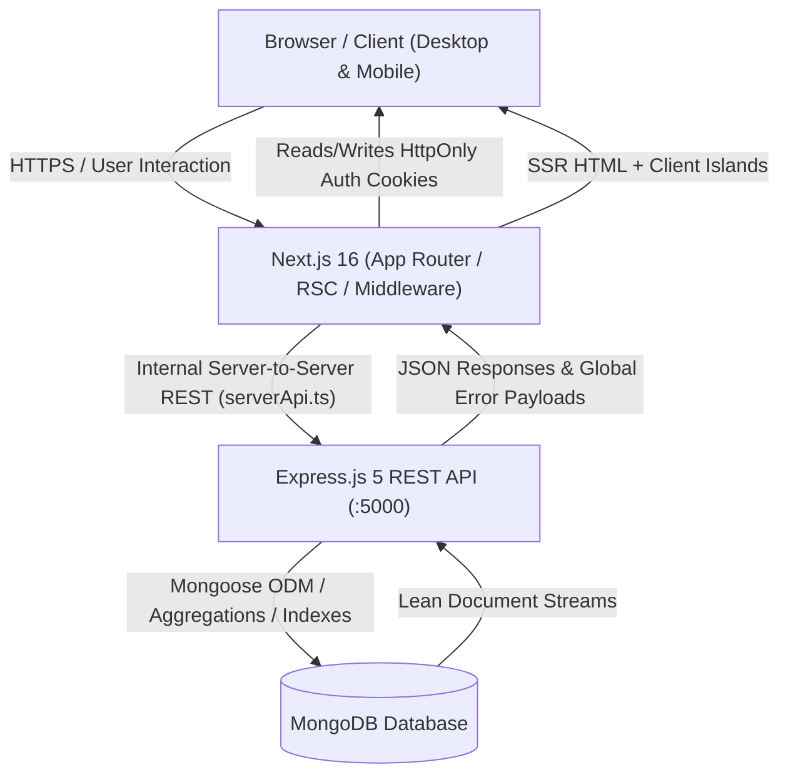

### Architectural Pipeline Highlights:
1. **Frontend Layer (Next.js 16 App Router):**
   - Utilizes React Server Components (RSC) for initial page loads, data fetching, and SEO optimization.
   - Client Component "Islands" are reserved for interactive forms, search inputs, modal dialogs, and chart visualizations.
2. **Security & Communication Bridge (`serverApi.ts`):**
   - Centralized network utility forwarding authentication cookies server-to-server.
   - Automatically intercepts network disconnects (`fetch failed`) and formats diagnostic error payloads.
3. **Backend API Layer (Express.js):**
   - Modular MVC architecture (`modules/doctor`, `modules/patient`, `modules/user`, `modules/auth`).
   - Mongoose validation schemas with pre-save password hashing and atomic transaction support.

---

## Technical Decisions

### Decision 1: HttpOnly Cookie Storage vs. LocalStorage JWTs
* **The Problem:** Storing JWT tokens in browser `localStorage` leaves tokens vulnerable to token theft via Cross-Site Scripting (XSS) and requires complex client-side refresh handlers that cause visual layout shifts.
* **Our Solution:** We implemented strict `HttpOnly`, `SameSite=Lax`, and `Secure` cookie-based authentication handled via Next.js Server Actions and server-side middleware.
* **The Benefit:** Zero JavaScript access to security tokens in the browser, eliminating the primary attack vector for token exfiltration. Additionally, Next.js Server Components can perform data queries directly during the initial HTML render before sending bytes to the client.

### Decision 2: React Server Components (RSC) vs. Client-Side Hydration (CSR)
* **The Problem:** Traditional single-page applications (SPAs) rely on `useEffect` hooks to fetch data after initial bundle download, causing multiple loading spinners, layout shifts (CLS), and exposing backend API endpoints directly to public network inspectors.
* **Our Solution:** We migrated all primary listing routes (`/dashboard`, `/dashboard/doctors`, `/dashboard/patients`) to React Server Components. Server components fetch data directly from the Express API within the internal network.
* **The Benefit:** Near-instant First Contentful Paint (FCP), zero exposure of private backend endpoints to client networks, smaller JavaScript bundle size sent over the wire, and seamless integration with Next.js streaming skeletons (`loading.tsx`).

### Decision 3: Resilient Offline Server Diagnostics & Centralized Error Formatting
* **The Problem:** When a microservice or backend database goes down, Next.js defaults to generic `"fetch failed"` errors or blank screens, confusing end-users and complicating developer debugging.
* **Our Solution:** We built a centralized error interceptor in `serverApi.ts` and coupled it with contextual error boundaries (`error.tsx`, `AlertBanner.tsx`).
* **The Benefit:** Clear, actionable feedback with diagnostic troubleshooting instructions (`cd server && pnpm run dev`) whenever connection to port 5000 is interrupted, paired with quick retry buttons and fallbacks.

---

## Performance & Optimization

- **MongoDB Compound Indexing**: Compound indexes on `{ doctor: 1, email: 1 }` and `{ status: 1, createdAt: -1 }` ensure sub-millisecond query execution on filtering and pagination.
- **Aggregation Pipelines for Analytics**: Analytics are computed via MongoDB `$facet` and `$group` aggregation pipelines rather than loading raw documents into Node.js memory.
- **Partial Prerendering (PPR) & Streaming**: Static page shells are served instantly from cache, while dynamic datasets stream via React Suspense boundaries.
- **Zero Heavy Client Dependencies**: Chart components are loaded dynamically, and icons are rendered as optimized SVG primitives to keep client bundle sizes minimal.

---

## Visual Evidence

### 1. Super Admin Dashboard (Desktop)
*Comprehensive overview showing KPI cards, real-time workload distribution bar chart, and patient admission trends.*
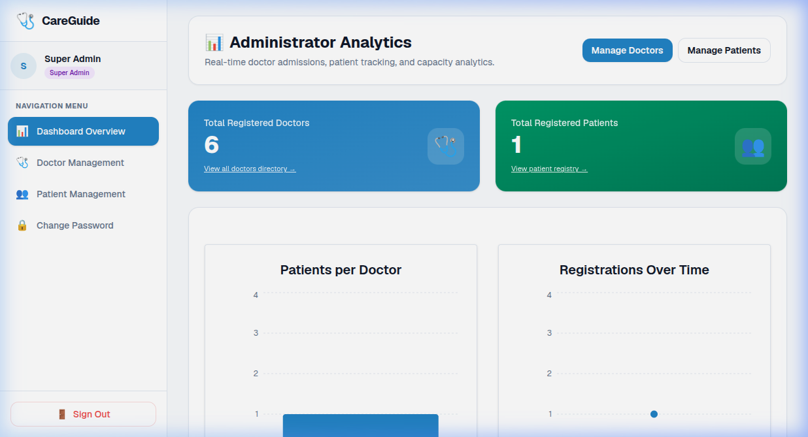

### 2. Clinical Analytics & Workload Distribution
*Visual analytics detailing patient counts per physician and recent admission distribution.*
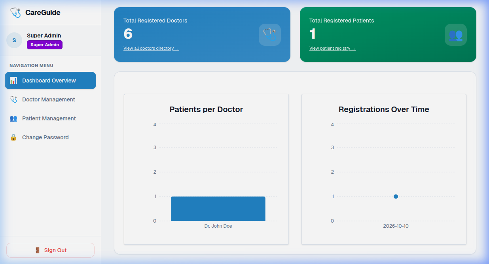

### 3. Responsive Mobile View
*Fully responsive interface with mobile navigation, touch-friendly touch targets, and fluid layout cards.*
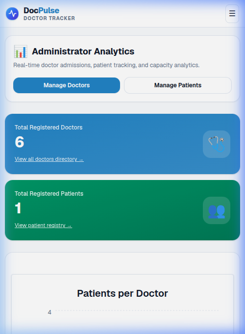

### 4. Doctors Management Directory
*Doctor search, specialization filtering, hospital credentials, and drill-down into assigned patient caseloads.*
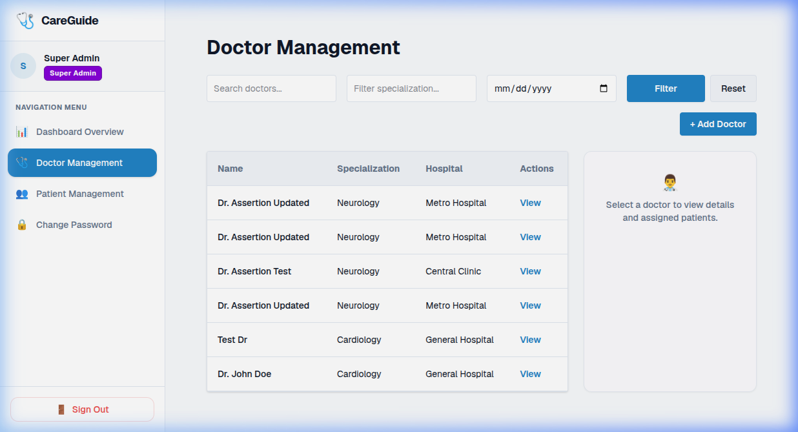

### 5. Patients Management Directory
*Patient roster featuring diagnosis filters, date range pickers, status badges, and attending physician indicators.*
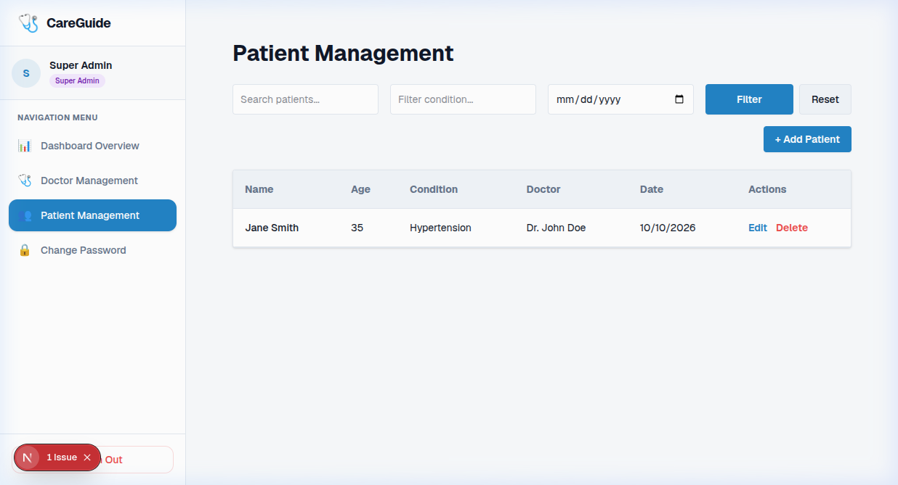

### 6. User Management & RBAC Center
*Administrative user directory showing user roles (`SUPER_ADMIN`, `DOCTOR`, `PATIENT`), verification states, and active statuses.*
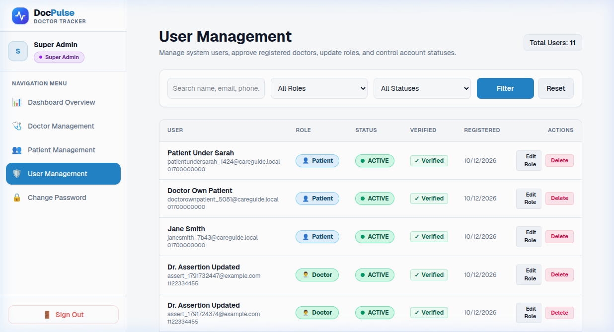

### 7. Scoped Doctor Portal
*Specialist interface limited to their assigned patients, active cases, and private patient note updates.*
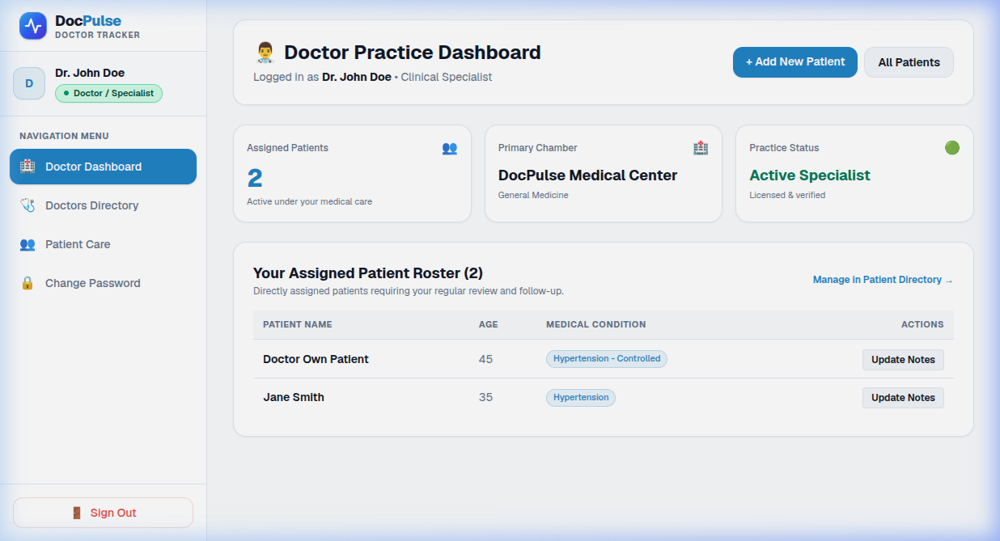

### 8. Patient Health Portal
*Patient view showing their personal medical chart, attending physician details, and diagnosis overview.*
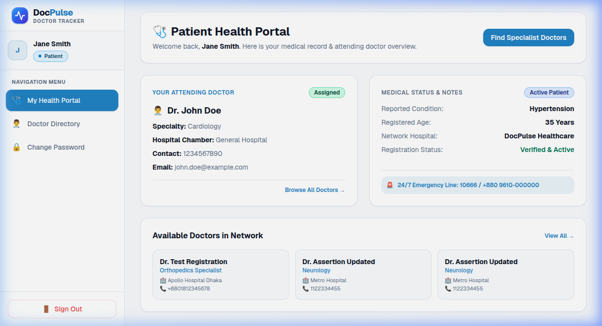

### 9. Custom 404 Not Found Page
*Themed 404 error page with medical pulse branding and quick recovery links.*
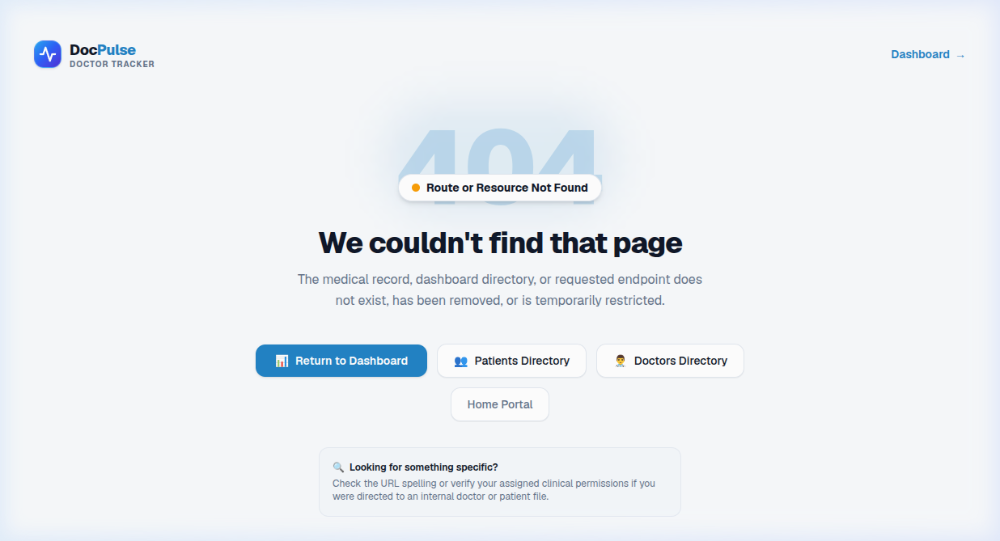

### 10. Offline Backend Server Diagnostics
*Intelligent error banner alerting users when the Express server (port 5000) is unreachable, providing developer instructions.*
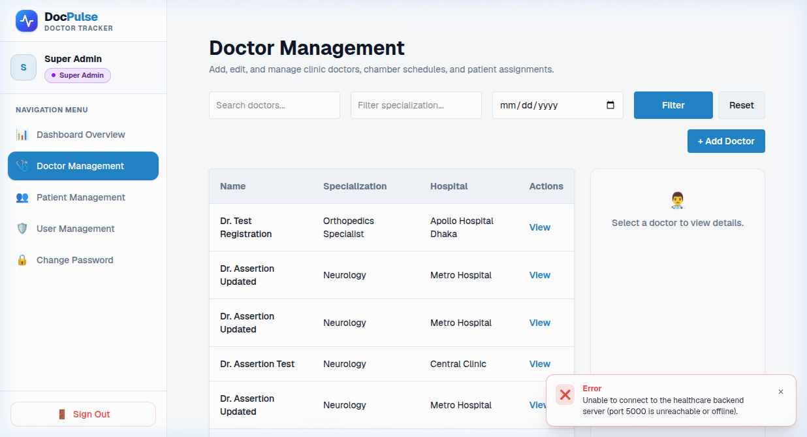

### 11. Backend Landing Page & System Monitor
*Live server status dashboard with uptime monitoring, environment specifications, and quick import utilities.*
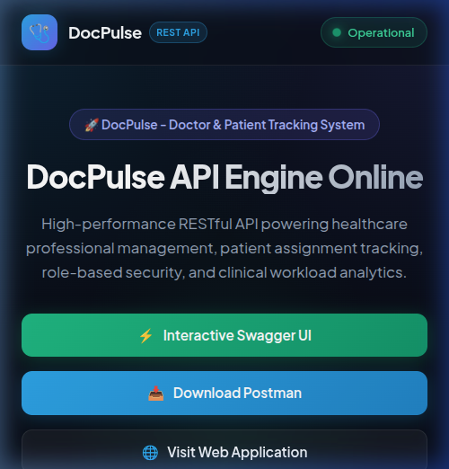

### 12. Interactive Swagger UI API Documentation
*OpenAPI 3.0 interactive testing console with Bearer token authentication, full schema models, and response previews.*
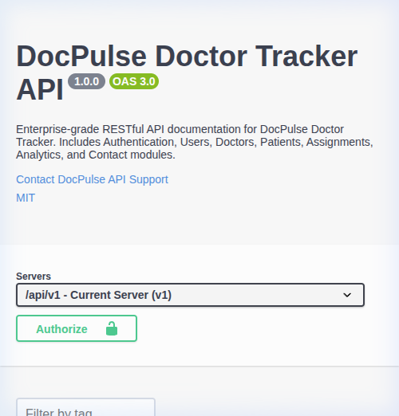

---

## Testing & Quality Assurance

### Run Frontend Build & Typecheck
```bash
cd client
pnpm run build
```

### Run Backend TypeScript Compilation
```bash
cd server
pnpm run build
```

---

## License
This project is developed for educational and healthcare administration tracking purposes. All rights reserved.
